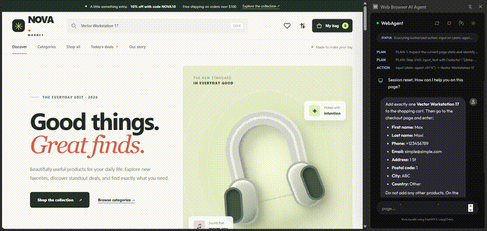

# Web Browser AI Agent 🌐🤖



A local, lightweight, and extremely fast Full-Stack Web Browser AI Agent built using a **Chrome Extension (Manifest V3)**, **FastAPI**, and **LangChain**.

The agent operates directly on the user's active, logged-in browser session. Instead of running a headless browser via heavy frameworks like Selenium or Playwright, the agent communicates with the Chrome Extension over a local WebSocket connection, executing actions directly via the browser's own scripting API.

---

## ✨ Features

- **In-Browser Execution**: Automates tasks directly on your active, logged-in tab (e.g. adding items to a cart, filling out forms, searching pages).
- **Gemini Minimalist UI**: A stunning, modern dark-themed chat interface matching the Google Gemini chat client layout.
- **Robust DOM Serialization**: Automatically parses webpage DOM structures, including nested open shadow roots and same-origin frames, filtering out non-interactive elements and tagging interactive nodes with a temporary `data-agent-id` attribute for reliable targeting.
- **Modern LangChain Loop**: Uses a custom tool-calling loop with `llm.bind_tools` and standard message streams, validated against the pinned LangChain 1.3 dependency line in `backend/constraints.txt`.
- **Multi-Model Support**: Pre-configured for **DeepSeek** (`deepseek-chat`), with seamless fallbacks to **Google Gemini** (`gemini-1.5-flash`), **OpenAI** (`gpt-4o-mini`), or **Anthropic** (`claude-3-5-sonnet-latest`).
- **Persistent History**: Every chat message and browser action is logged to a local SQLite database (`backend/agent_history.db`), retrievable via `GET /sessions` and `GET /sessions/{id}`.
- **Context-Aware Agent Loop**: Caps the number of DOM elements sent per step, collapses older DOM snapshots to keep context size bounded across long tasks, and remembers a short summary of prior tasks completed in the same session.
- **Step-Budgeted Execution**: `MAX_AGENT_STEPS` limits executed browser actions, not just model reasoning turns, so multi-action runs stop at a predictable budget.
- **Strict Action Correlation**: Browser responses must match both the active run and action ID, preventing delayed packets from an older action from being applied to a newer one.
- **Replay & Screenshot Grounding**: Every agent run gets a durable replay timeline with plan/action/verify/self-check events, DOM summaries, and before/after screenshots exportable as Markdown or HTML.
- **Expanded Browser Tools**: Supports navigation, keyboard events, select controls, hover menus, browser history, reload, wait steps, visible page-text reads, clear/double-click/toggle, wait-for-text, modal/download detection, paste, and basic drag/drop.
- **Two Access Modes**: Choose **Full access** to run browser actions without interruptions, or **Ask every time** to confirm every action from the sidepanel.
- **Workflow Library**: Save successful replays as lightweight reusable workflows, reload them into the prompt box, and adjust parameters before running again.
- **Sidepanel Replay, Workflow & History Viewer**: Configure the backend URL and optional auth token, inspect sessions/replays/workflows, search local records, export replays, and clear local history without leaving the sidepanel.
- **Local Evaluation Suite**: Ships with mock form, shop, table, modal, and fake-login pages plus a smoke-test runner that emits JSON/Markdown-ready benchmark summaries.
- **Sensitive Value Redaction**: Credential-like input values are redacted before browser actions are written to local history.
- **Credential-Safe DOM Capture**: Password, token, API-key, card, and similar field values are omitted before DOM data is sent to the model.
- **PII-Safe DOM Capture**: Existing email, telephone, numeric, credential, and payment-like values are omitted before page state is sent to the model.
- **Privacy-First Screenshots**: Replay screenshots are disabled by default and require explicit `CAPTURE_SCREENSHOTS=true` opt-in.
- **Bounded Local Retention**: Session-linked history is pruned after seven days by default; configure `HISTORY_RETENTION_DAYS=0` only when indefinite local retention is intentional.
- **Optional Local Auth**: Set `AGENT_AUTH_TOKEN` to protect the WebSocket and session history endpoints on shared machines.

---

## 📂 Project Structure

```
browser-agent/
├── extension/             # Chrome Extension (Frontend UI & Execution)
│   ├── manifest.json      # MV3 configuration & permissions
│   ├── sidepanel.html     # Minimalist chat sidebar layout
│   ├── sidepanel.js       # WebSocket manager & page message broker
│   ├── sidepanel.css      # Custom dark-theme stylesheet
│   ├── background.js      # Service worker configuring side panel behavior
│   └── content.js         # Page script for DOM parsing & event dispatching
│
├── backend/               # FastAPI Backend (LangChain Brain)
    ├── main.py            # WebSocket server endpoint, routing & history API
    ├── agent.py           # LangChain tool binding & Custom Agent Loop
    ├── database.py        # SQLite persistence for sessions/messages/actions
    ├── evaluation.py      # Local mock-page evaluation smoke runner
    ├── requirements.txt   # Python package dependencies
    └── .env.example       # Template for required environment variables
└── evals/mock_pages/      # Static benchmark pages for local evaluation
```

---

## 🛠️ Installation & Setup

### One-command Windows setup

Install **Python 3.11+** with **Add Python to PATH**, and Google Chrome. Clone this repository once and open PowerShell in its root folder. Run:

```powershell
powershell -NoProfile -ExecutionPolicy Bypass -File .\setup.ps1
```

This process-only execution policy applies to the new PowerShell process; it does not change your saved policy. Organization-enforced policies may still apply.

The command creates/reuses `venv`, installs the pinned dependencies when the dependency files change, and creates `.env` only if missing. When configuration is missing or invalid, it opens `.env` in Notepad. Enter `LLM_PROVIDER`, `LLM_MODEL_NAME`, and the matching API key, save, then press Enter in the terminal. Validation checks required settings and placeholder keys locally; it does not verify credentials with the provider. Existing valid settings skip the editor on later runs.

The backend starts only after configuration validation and reports readiness at its configured address. The frontend is the bundled Chrome extension: it has no package installation or separate frontend server and does not require Node.js to launch. Chrome opens to `chrome://extensions/`; on first use enable **Developer mode**, choose **Load unpacked**, and select the printed `extension` folder. Chrome requires these manual actions. On later runs reuse the installed extension; reload it after updating its files. Open its sidepanel to connect. For a custom host/port, update the backend URL in extension Settings.

Use the same command on subsequent launches, without cloning again. Press **Ctrl+C** in the terminal to stop the backend. A failed installation or startup stops with an error; if the port is occupied, stop the existing server or change `PORT` in `.env`. If Python is missing, install it using the printed instructions and rerun. To suppress opening Chrome, append `-SkipBrowser`. The manual setup below remains available for other platforms.

### 1. Run the FastAPI Backend

1. **Clone the repository and open its root folder**:
   ```bash
   git clone https://github.com/rashidiff/WebAgent.git
   cd WebAgent
   ```

2. **Create and activate a virtual environment**:
   ```bash
   python -m venv venv
   # On Windows:
   .\venv\Scripts\activate
   # On macOS/Linux:
   source venv/bin/activate
   ```

3. **Install dependencies**:
   ```bash
   pip install -r backend/requirements.txt -c backend/constraints.txt
   ```
   The backend now ships with pinned dependency versions in `constraints.txt` and mirrored project metadata in the repo-level `pyproject.toml`.

4. **Configure your API keys**:
   Copy the provided template and fill in your values:
   ```bash
   cp .env.example .env
   ```
   ```env
   LLM_PROVIDER=deepseek
   LLM_MODEL_NAME=deepseek-chat
   LLM_MAX_TOKENS=2048
   MAX_AGENT_STEPS=15
   ACTION_TIMEOUT_SECONDS=40
   MAX_DOM_ELEMENTS=150
   DEEPSEEK_API_KEY=your_deepseek_api_key_here
   ```
   Only the API key matching your chosen `LLM_PROVIDER` (`gemini`, `openai`, `anthropic`, or `deepseek`) is required for local use. `MAX_AGENT_STEPS` counts executed browser tool calls, and `MAX_DOM_ELEMENTS=150` should stay aligned with the extension-side DOM capture budget. See `.env.example` for the full list of supported variables.

   Localhost runs do not require an extension ID or local auth token. For a shared machine or a non-localhost host, set `AUTH_REQUIRED=true`, generate `AGENT_AUTH_TOKEN`, and set `WS_ALLOWED_ORIGINS` to the exact `chrome-extension://<extension-id>` origin.

5. **Start the server**:
   ```bash
   python -m backend.main
   ```
   *The server starts listening on `http://127.0.0.1:8000`.*

---

### 2. Install the Chrome Extension

1. Open Google Chrome and navigate to `chrome://extensions/`.
2. Toggle on **Developer mode** in the top-right corner.
3. Click **Load unpacked** in the top-left corner.
4. Select the `extension` folder from this repository.
5. Pin the **Web Browser AI Agent** extension to your toolbar.

For local HTML files opened with a `file://` URL, open the extension's **Details** page and enable **Allow access to file URLs**. Chrome requires this user-controlled switch even when the extension manifest declares `file:///*` host permission.

The extension requests access to regular `http` and `https` websites when it is installed, so no per-site permission prompt is needed. Chrome still protects internal pages such as `chrome://` and the Chrome Web Store. In **Full access** mode (the default), actions run immediately; choose **Ask every time** in the sidepanel Settings to review every action. Each browser response remains bound to a short-lived per-action capability token.
The current extension defaults wait about `900ms` after tab-level navigation and `700ms` after DOM actions before re-reading the page state.

---

## 🚀 How to Use

1. Go to any public website (e.g. `https://google.com` or `https://codeforces.com`).
2. Click the **Web Browser AI Agent** icon in your toolbar to open the sidebar.
3. Once the status shows **`Connected`** in green, type your instruction in the prompt box (e.g. `"Search for DeepSeek on Google"` or `"List the next Codeforces contests"`).
4. Click **Send** and watch the agent navigate, click, type, and summarize findings in real-time.

---

## 🗄️ Session History

Every WebSocket connection is logged as a session in `backend/agent_history.db` (SQLite, created automatically on first run, or `AGENT_DB_PATH` if set). Sensitive input values are redacted before they are written to the action log. Replays, workflows, and eval results are stored in the same local database.

- `GET /sessions?limit=20&offset=0` — lists sessions with pagination metadata.
- `GET /sessions/{session_id}` — returns the full list of chat messages and browser actions recorded for that session.
- `DELETE /sessions/{session_id}` — deletes one recorded session.
- `DELETE /sessions` — clears all recorded session history.
- `GET /runs` / `GET /runs/{run_id}` — lists and opens replay timelines.
- `GET /runs/{run_id}/export?format=html|markdown` — exports a replay for sharing or debugging.
- `GET /workflows` / `POST /workflows` / `POST /workflows/{id}/run` / `DELETE /workflows/{id}` — manages saved workflow templates.
- `POST /evals/run` / `GET /evals` — runs and lists local evaluation smoke results.

When `AUTH_REQUIRED=true`, pass `AGENT_AUTH_TOKEN` as `X-Agent-Token` or configure the same token in the sidepanel settings. HTTP authentication never accepts tokens in query strings; replay exports are fetched with an authenticated header and opened from a temporary local blob URL. In that mode, WebSocket connections are restricted to the exact `WS_ALLOWED_ORIGINS` extension origin; wildcards are rejected.

The sidepanel stores the backend URL and access mode persistently, but keeps `AGENT_AUTH_TOKEN` in Chrome session storage so it is discarded when the browser session ends.

---

## 🧪 Local Evaluation

Run the built-in smoke suite against static mock pages:

```bash
python -m backend.evaluation
```

Optional machine-readable outputs:

```bash
python -m backend.evaluation --json eval-results.json --markdown eval-summary.md
```

The V1 suite validates that the demo pages used for form filling, cart actions, table search, modal detection, and credential-field safety contain the expected markers. It is intentionally lightweight so it can run in CI and act as a foundation for future end-to-end browser-agent benchmarks.

The smoke suite is a fixture/marker check, not a full browser execution benchmark. For production-quality changes, add a Chrome-driven end-to-end scenario and assert the post-action page state.

---

## ✅ Development Checks

```bash
python -m py_compile backend/main.py backend/agent.py backend/database.py backend/settings.py backend/schemas.py backend/evaluation.py
python -m unittest discover backend/tests
python -m backend.evaluation
node --check extension/content.js
node --check extension/sidepanel.js
```
